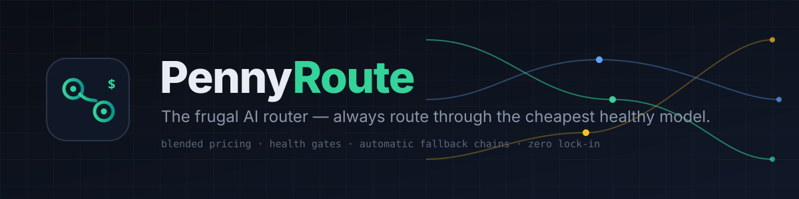
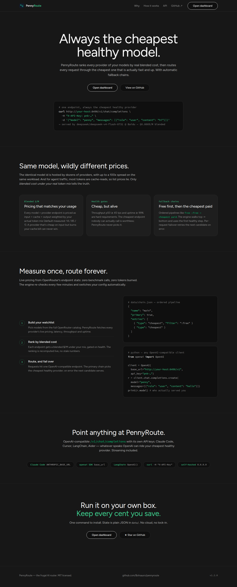
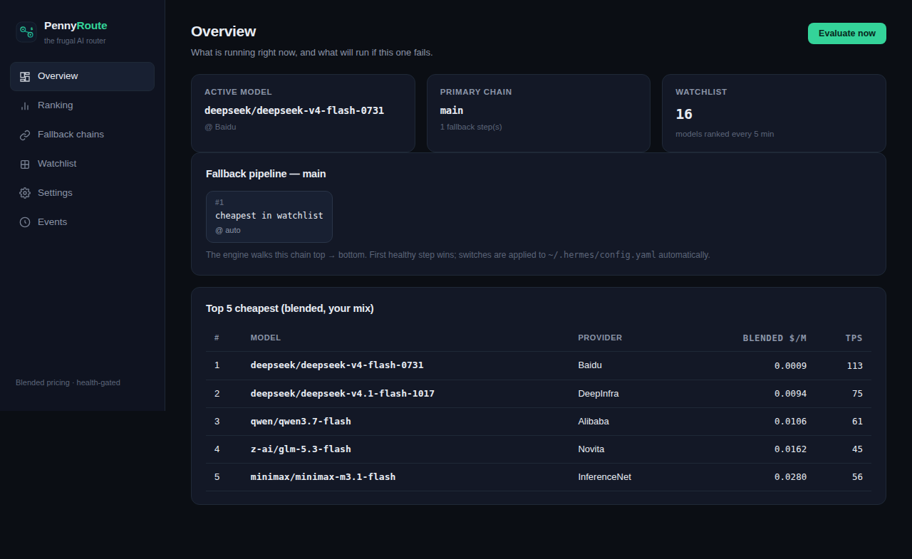
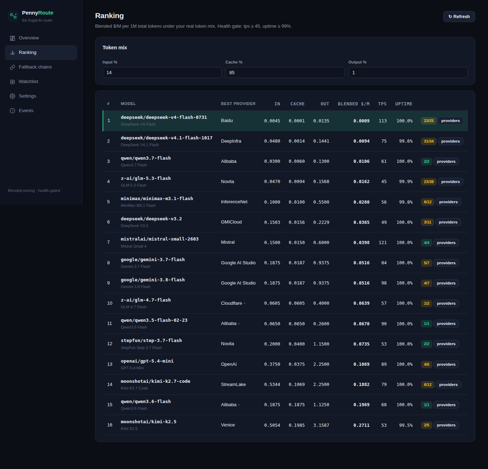
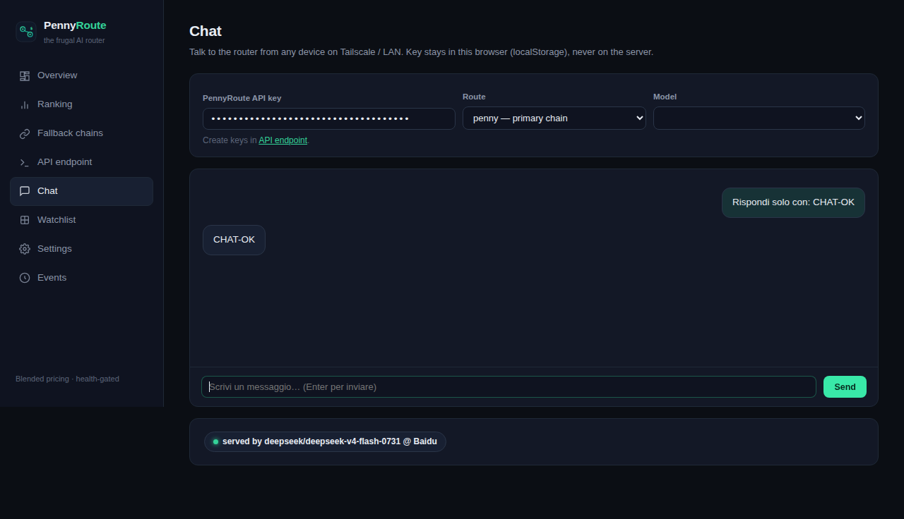

<p align="center">
  
</p>

<h1 align="center">PennyRoute</h1>
<p align="center">
  <b>The frugal AI router.</b> Rank model providers by real, blended cost — and always route through the cheapest healthy one, with automatic fallback chains.<br>
  Built for OpenRouter. Zero lock-in · zero build · self-hosted · MIT
</p>

<p align="center">
  
  
  
  
  
</p>

---

## One-command install

```bash
wget -qO- https://raw.githubusercontent.com/Bohsauro/pennyroute/main/install.sh | bash
```

Opens on `http://<your-ip>:8490` (LAN + Tailscale friendly — binds `0.0.0.0`).
Installer creates a venv, installs deps, saves your OpenRouter key, and (on systemd hosts) registers a live service. Manual install:

```bash
git clone https://github.com/Bohsauro/pennyroute.git && cd pennyroute
pip install -r requirements.txt
cp .env.example .env        # then edit .env and paste your OpenRouter key
uvicorn pennyroute.app:app --host 0.0.0.0 --port 8490
```

## Why

The **same model** is served by many providers at wildly different prices — a **10–100× spread on the same model ID**. And for agentic workloads most of your tokens are *cache-reads* of a system prompt re-sent every turn, so the price that matters is the **blended** one under *your* token mix — not the list price.

PennyRoute measures, ranks, and switches — automatically.

## What it does

- **Blended cost ranking** — every model × provider endpoint priced with *your* real token mix (input / cache-read / output). Defaults to a measured agent workload: **14% input / 85% cache / 1% output**. Providers hiding their cache price get a pessimistic estimate, flagged `≈` in the UI.
- **Health gates** — cheap but dead is worthless: endpoints need `throughput p50 ≥ 45 tps` and `uptime ≥ 99%`.
- **Automatic fallback chains**:
  ```
  cheapest :free model  →  cheapest paid model  →  fixed model @ fixed provider
  ```
  The engine walks the chain top → bottom and uses the first healthy step.
- **Auto-routing** — a background engine re-evaluates every N minutes and applies the cheapest healthy choice (writes your config, reloads). Zero benchmark calls, zero tokens burned: it reads OpenRouter's live endpoint stats.
- **It *is* the API** — OpenAI-compatible `/v1/chat/completions` + `/v1/models` with its own API keys. Point the `openai` SDK, LangChain, Aider, Cursor, Claude Code, or anything at PennyRoute, and every request is served by the cheapest healthy provider *at that moment*. Streaming included, per-request failover included.
- **Built-in Chat** — paste your PennyRoute key in the WebUI and talk to the router from any device on the network. Shows exactly which model served each reply.
- **Preset watchlists** — one-click `frugal` (flash-class), `balanced` (mid + coding), `premium` (Opus/Sonnet/GPT/Gemini — still routed to the cheapest healthy provider), `free` (`:free` only).
- **WebUI** — live routing telemetry (trends, donut, cost ladder), ranking with provider drill-down, chain editor, key management, search across the full OpenRouter catalog, settings, event log.
- **Hermes Agent native** — writes `model.default` + `provider_routing.order` (as a *real YAML list* — not the string that silently breaks the pin) into `~/.hermes/config.yaml`.

## Screenshots

| Landing | Overview | Ranking | Chat |
|---|---|---|---|
|  |  |  |  |

## Use it as your AI endpoint

Create a key in the WebUI (**API endpoint** → *Create key*), then:

```bash
curl http://YOUR-IP:8490/v1/chat/completions \
  -H "Content-Type: application/json" \
  -H "X-API-Key: pnk-YOUR-KEY" \
  -d '{"model": "penny", "messages": [{"role": "user", "content": "hello"}], "stream": true}'
```

```python
from openai import OpenAI
client = OpenAI(base_url="http://YOUR-IP:8490/v1", api_key="pnk-YOUR-KEY")
r = client.chat.completions.create(model="penny", messages=[{"role": "user", "content": "hello"}])
print(r.model)  # the model that actually served you
```

**Model field routing:**

| `model` value | Behaviour |
|---|---|
| `"penny"` | primary fallback chain resolves it (cheapest healthy provider at that moment) |
| `"penny:<chain>"` | a named chain |
| any model id | that model, routed to its cheapest healthy provider |

Failover is per-request: a provider error silently retries the next candidate — the client never sees the switch. Every response carries `pennyroute.served_by`.

## How routing works

```
            ┌──────────────┐   every N min    ┌─────────────────────┐
 watchlist ─▶  rank models  ├─────────────────▶ │ resolve primary     │
 (preset or │  × providers  │  blended $/M      │ chain top → bottom  │
  custom)   └──────────────┘  health gates    └─────────┬───────────┘
                                                        │ first healthy step
                                                        ▼
                                          ┌──────────────────────────┐
                                          │ config.yaml unchanged?   │
                                          │  yes → sleep             │
                                          │  no  → rewrite + reload  │
                                          └──────────────────────────┘
```

**Blended cost** (per 1M total tokens, under your mix):

```
blended $/M = in_f · input + cache_f · cache_read + out_f · output
```

## Presets

Applied with one click in the **Watchlist** tab (or via `POST /api/presets/<name>`):

| Preset | Models | Use case |
|---|---|---|
| `frugal` | DeepSeek V4.1/V4 Flash, GLM 5.3 Flash, Qwen3.7 Flash, MiniMax M3.1, Mistral Small, StepFun, Gemini 3.8 Flash | cheap agent/coding |
| `balanced` | frugal + Kimi K2.7 Code, GPT-5.4 Mini, Gemini 3.7 Flash | mid + coding specialists |
| `premium` | Opus 5.5, Sonnet 5.5, GPT-5.4, Gemini 4 Argon, GLM 5.3 Prime, Qwen Max Prime | top quality, still cheapest provider |
| `free` | `:free` model variants | zero cost when available |

## Fallback chains

Chains live in `data/chains.json`, edited visually in the WebUI. Step types:

| Type | Meaning |
|---|---|
| `cheapest` | cheapest healthy endpoint in the watchlist; optional `filter` (e.g. `":free"`) |
| `model` | fixed model; provider `auto` or pinned |

Free-first example:

```json
{ "name": "free-first", "primary": false, "auto_apply": false,
  "entries": [ { "type": "cheapest", "filter": ":free" }, { "type": "cheapest" } ] }
```

The **primary** chain is what the engine enforces. Others are recipes you promote with one click.

## Configuration

All state is plain JSON in `data/` — no database:

| File | Purpose |
|---|---|
| `data/models.json` | watchlist |
| `data/chains.json` | fallback chains |
| `data/settings.json` | cost mix, health gates, interval, restart behaviour |
| `data/keys.json` | `/v1` API keys (hashed, shown once) |
| `data/telemetry.json` | routing snapshots for the 24h trend |
| `data/events.jsonl` | append-only switch/error log |

```json
{ "mix": { "in": 0.14, "cache": 0.85, "out": 0.01 },
  "min_tps": 45, "min_uptime": 99.0, "interval_min": 5, "gateway_restart": true }
```

Measure *your* mix once (export your OpenRouter activity CSV, count tokens by type), set it in **Settings**, and the ranking becomes exactly your wallet's point of view.

## Production notes

- **Reachability**: binds `0.0.0.0` by default — reach it via LAN or Tailscale.
- **Security**: the WebUI is unauthenticated (LAN tool). The `/v1` endpoint requires a `pnk-…` key. Put a reverse proxy in front if you expose it publicly.
- **Hermes integration**: PennyRoute writes `~/.hermes/config.yaml`; restart your gateway after a manual change, or let the engine do it (`gateway_restart: true`).
- **Auto-apply**: starts ON for the primary chain. Want watch-mode first? Flip `auto_apply` off in the Chains tab, watch Events for a few cycles, then enable.

## Project layout

```
pennyroute/
├── pennyroute/
│   ├── app.py          # FastAPI routes + static serving
│   ├── router_proxy.py # OpenAI-compatible /v1 proxy + failover
│   ├── engine.py       # fallback-chain router (background thread)
│   ├── ranking.py      # blended-cost ranking + chain resolution
│   ├── orclient.py     # OpenRouter client (cached)
│   ├── keys.py         # API key management (hashed)
│   └── store.py        # JSON state + presets
├── static/             # zero-build WebUI
├── assets/             # banner + screenshots
├── install.sh          # one-command installer (+systemd)
├── docs/               # landing page (GitHub Pages)
└── data/               # runtime state (gitignored)
```

## Roadmap

- [ ] Real spend tracking from the OpenRouter activity API
- [ ] Slack/Telegram/Discord notifications on switch
- [ ] Multi-provider backends beyond OpenRouter
- [ ] Docker image

## Disclaimer

PennyRoute changes your agent's model configuration automatically. Start with `auto_apply: false`, watch the Events tab for a few cycles, then flip it on.

## License

MIT — see [LICENSE](LICENSE).