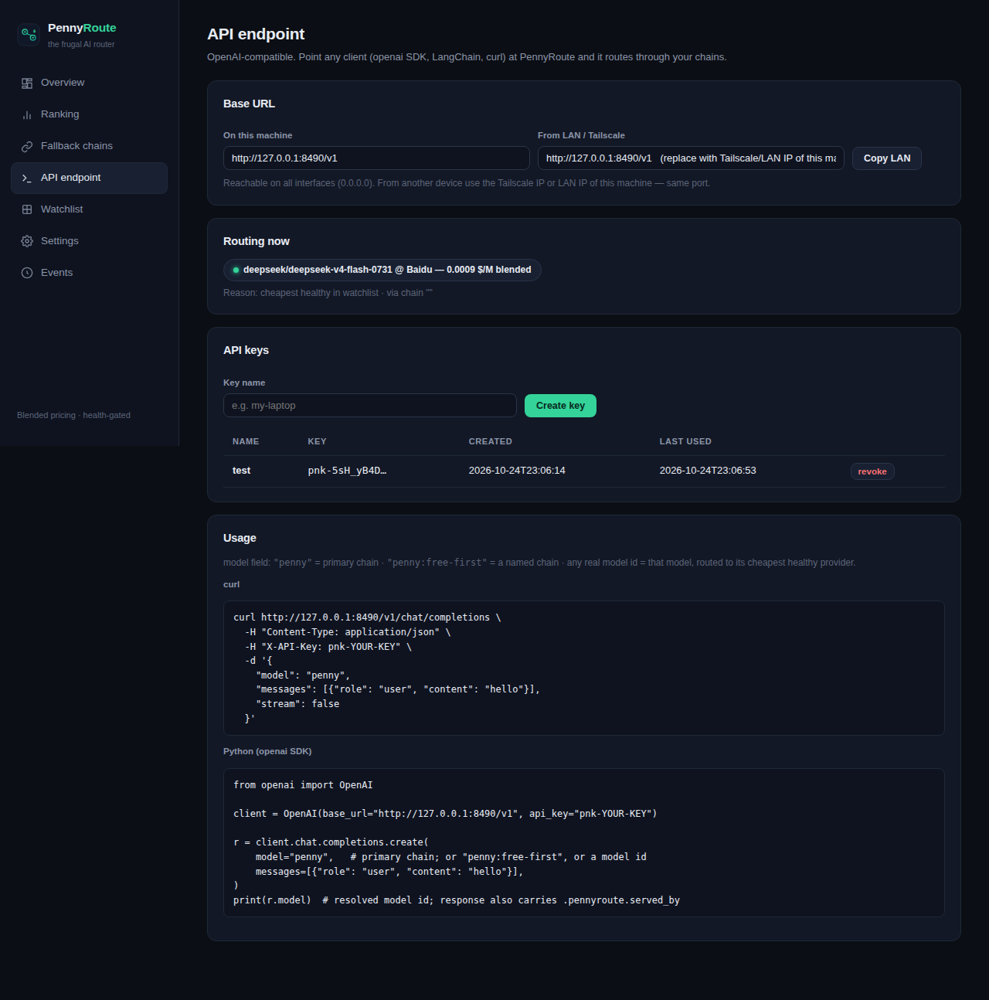

<p align="center">
  
</p>

<h1 align="center">PennyRoute</h1>
<p align="center">
  <b>The frugal AI router.</b> Rank model providers by real, blended cost — and always route through the cheapest healthy one, with automatic fallback chains.<br>
  Built for OpenRouter. Zero lock-in. No build step.
</p>

<p align="center">
  
  
  
  
</p>

---

## Why

The **same model** is served by many providers at wildly different prices — sometimes a **10x spread on the same model ID**. And for agentic workloads, most of your tokens are *cache-reads* of a big system prompt re-sent every turn, so the price that actually matters is the **blended** one under *your* token mix, not the list price.

PennyRoute measures, ranks, and switches — automatically.

## What it does

- **Blended cost ranking** — prices every model × provider endpoint using *your* real token mix (input / cache-read / output), not just list price. Defaults to the measured mix of a real agentic workload: **14% input / 85% cache / 1% output**.
- **Health gates** — a cheap provider nobody can serve is worthless. Endpoints must pass `throughput p50 ≥ 45 tps` and `uptime ≥ 99%` to be eligible.
- **Fallback chains** — ordered pipelines like:

  ```
  cheapest :free model  →  cheapest paid model  →  fixed model @ fixed provider
  ```

  The engine walks the chain top → bottom and uses the first *healthy* step.
- **Auto-routing** — a background engine re-evaluates the primary chain every N minutes. If the best healthy choice changes, PennyRoute rewrites its config and restarts the gateway. Zero tokens burned (no benchmark calls — pricing comes from OpenRouter's live endpoint stats).
- **It *is* the API** — an OpenAI-compatible endpoint (`/v1/chat/completions`, `/v1/models`) with its own API keys. Point the `openai` SDK, LangChain, Aider, or anything at PennyRoute: every request is routed through your fallback chain and served by the cheapest healthy provider at that moment. Streaming included.
- **Built-in Chat** — paste your PennyRoute key in the WebUI and talk to the router from any device on Tailscale / LAN (phone included). Shows which model served each reply.
- **WebUI** — overview, live ranking, chain editor, key management, model search across the full OpenRouter catalog, settings, event log.
- **Hermes Agent native** — writes `model.default` + `provider_routing.order` (as a *real YAML list* — the well-known silent-pin pitfall) into `~/.hermes/config.yaml`.

## Screenshots

| Overview | Ranking | API endpoint | Chat |
|---|---|---|---|
|  |  |  |  |

## Quickstart

```bash
git clone https://github.com/Bohsauro/pennyroute.git
cd pennyroute
pip install -r requirements.txt

# export your OpenRouter key (or let PennyRoute read it from ~/.hermes/.env)
export OPENROUTER_API_KEY=sk-or-your-key

uvicorn pennyroute.app:app --host 0.0.0.0 --port 8490
```

Open `http://localhost:8490`. Done.

> Binding to `0.0.0.0` makes it reachable from your LAN / Tailscale — handy if PennyRoute runs on a headless box.

## Use it as your AI endpoint

Create a key in the WebUI (**API endpoint** page → *Create key*), then point any OpenAI-compatible client at PennyRoute:

```bash
curl http://YOUR-IP:8490/v1/chat/completions \
  -H "Content-Type: application/json" \
  -H "X-API-Key: pnk-YOUR-KEY" \
  -d '{
    "model": "penny",
    "messages": [{"role": "user", "content": "hello"}],
    "stream": true
  }'
```

```python
from openai import OpenAI

client = OpenAI(base_url="http://YOUR-IP:8490/v1", api_key="pnk-YOUR-KEY")
r = client.chat.completions.create(model="penny", messages=[{"role": "user", "content": "hello"}])
print(r.model)  # the model that actually served the request
```

**Model field routing:**

| `model` value | Behaviour |
|---|---|
| `"penny"` | the **primary** fallback chain resolves it (cheapest healthy at that moment) |
| `"penny:<chain-name>"` | a specific named chain |
| any model id (e.g. `"z-ai/glm-5.3-flash"`) | that model, routed to its cheapest healthy provider |

Failover is per-request: if a provider errors mid-chain, PennyRoute silently retries the next candidate — the client never sees the switch. Responses carry a `pennyroute.served_by` field telling you exactly who served it.

## How routing works

```
            ┌──────────────┐   every N min    ┌───────────────────┐
 watchlist ─▶  rank models  ├─────────────────▶ │ resolve primary    │
 (any slug) │  × providers  │  blended $/M      │ chain top → bottom │
            └──────────────┘   health gates    └────────┬──────────┘
                                                        │ first healthy step
                                                        ▼
                                          ┌─────────────────────────┐
                                          │ config.yaml unchanged?  │
                                          │  yes → sleep            │
                                          │  no  → rewrite + reload │
                                          └─────────────────────────┘
```

**Cost metric** (per 1M total tokens, under your mix):

```
blended $/M = in_f · input + cache_f · cache_read + out_f · output
```

Providers that don't expose a cache-read price get a pessimistic estimate (`cache = input`) and are marked with `≈` in the UI — so a "cheap" estimate can't silently win on invented numbers.

## Fallback chains

Chains are stored in `data/chains.json` and edited in the UI. Two step types:

| Type | Meaning |
|---|---|
| `cheapest` | pick the cheapest healthy endpoint across the watchlist. Optional `filter` narrows candidates (e.g. `":free"`). |
| `model` | a fixed model; provider can be `auto` (cheapest healthy) or pinned to a specific provider name. |

Example — *free first, then the cheapest paid model*:

```json
{
  "name": "free-first",
  "primary": false,
  "auto_apply": false,
  "entries": [
    { "type": "cheapest", "filter": ":free" },
    { "type": "cheapest" }
  ]
}
```

The chain marked **primary** is the one the engine enforces. Others are saved recipes you can promote with one click.

## Configuration

All state lives in `data/` — plain JSON, no database:

| File | Purpose |
|---|---|
| `data/models.json` | your watchlist (add/remove in the UI, from the full OpenRouter catalog) |
| `data/chains.json` | fallback chains |
| `data/settings.json` | cost mix, health gates, engine interval, gateway-restart behaviour |
| `data/keys.json` | API keys for the `/v1` endpoint (hashed, shown once) |
| `data/events.jsonl` | append-only log of every switch and engine decision |

Key settings (also editable in the UI):

```json
{
  "mix": { "in": 0.14, "cache": 0.85, "out": 0.01 },
  "min_tps": 45,
  "min_uptime": 99.0,
  "interval_min": 5,
  "gateway_restart": true
}
```

Measure *your* mix once (export your OpenRouter activity CSV and count tokens by type), set it here, and the ranking becomes exactly your wallet's point of view.

## Project layout

```
pennyroute/
├── pennyroute/
│   ├── app.py          # FastAPI routes + static serving
│   ├── router_proxy.py # OpenAI-compatible /v1 proxy with per-request failover
│   ├── keys.py         # API key management (hashed)
│   ├── engine.py       # fallback-chain router (background thread)
│   ├── ranking.py      # blended-cost ranking + chain resolution
│   ├── orclient.py     # OpenRouter client with caching
│   └── store.py        # JSON state persistence
├── static/             # zero-build WebUI (HTML/CSS/JS)
├── assets/             # banner + screenshots
└── data/               # your state (created on first run, gitignored)
```

## Roadmap

- [ ] Cron/daemon mode outside the API process
- [ ] Cost tracking from the OpenRouter activity API (real spend, not estimates)
- [ ] Slack/Telegram notifications on switch
- [ ] Multi-provider backends (Beyond OpenRouter)

## Disclaimer

PennyRoute changes your agent's model configuration automatically. Start with `auto_apply: false`, watch the Events tab for a few cycles, then flip it on.

## License

MIT — see [LICENSE](LICENSE).
